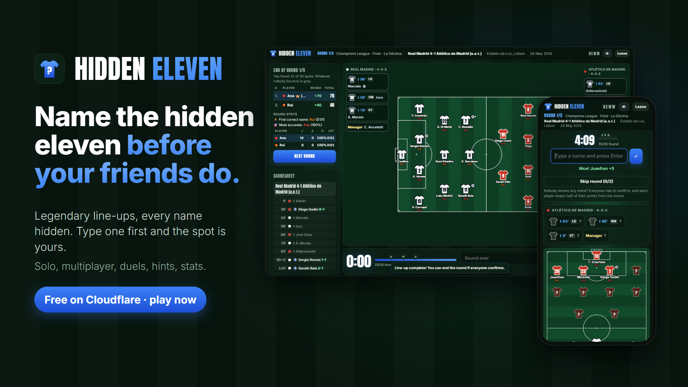
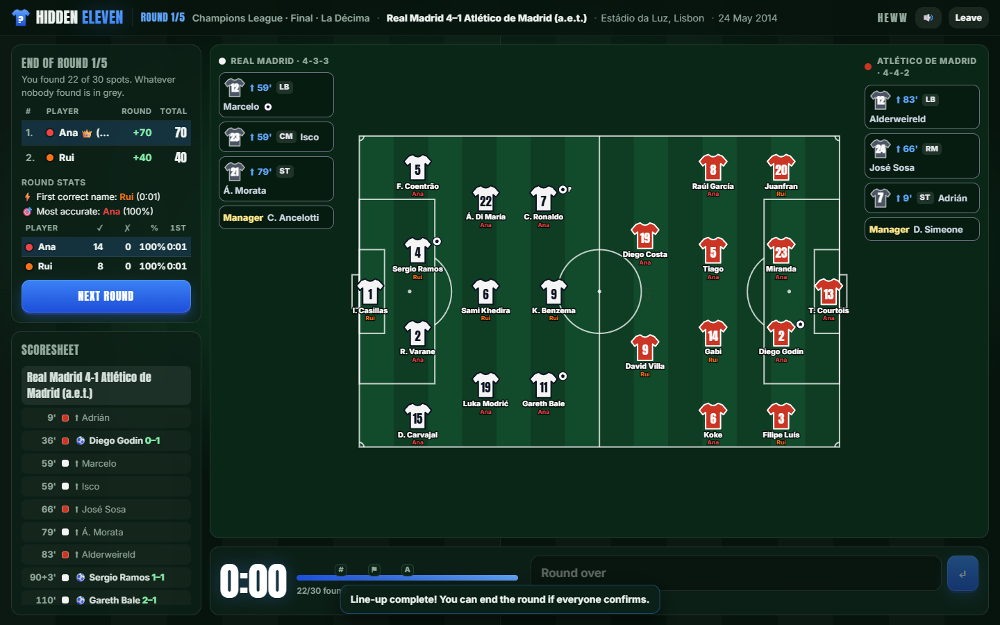
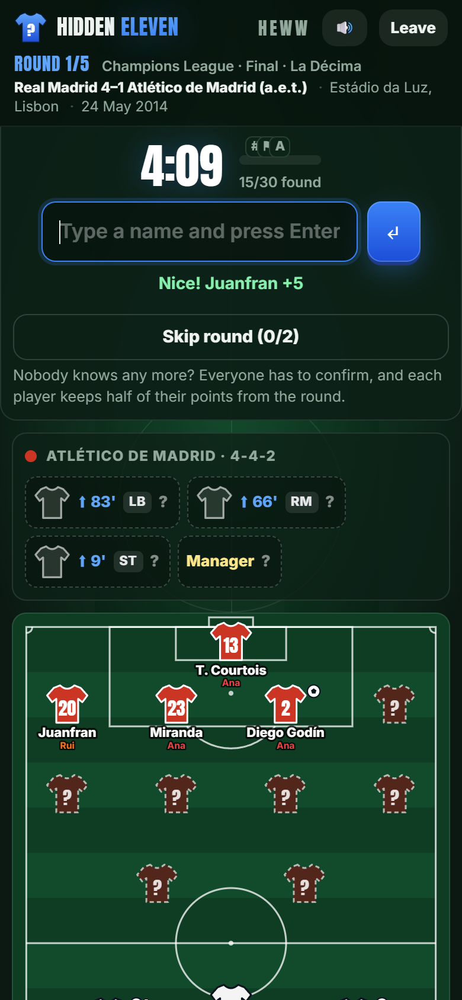
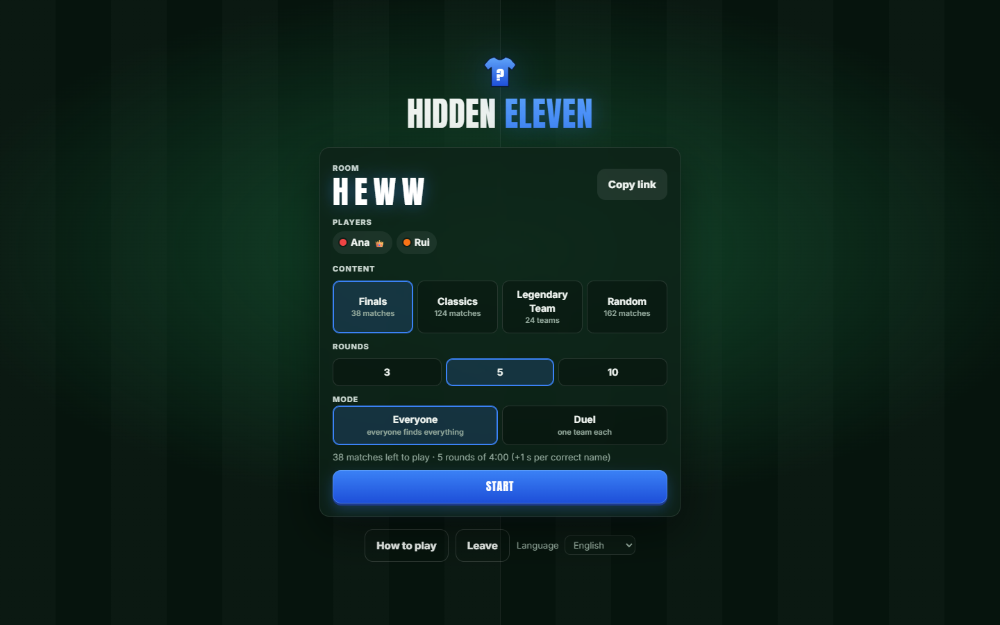
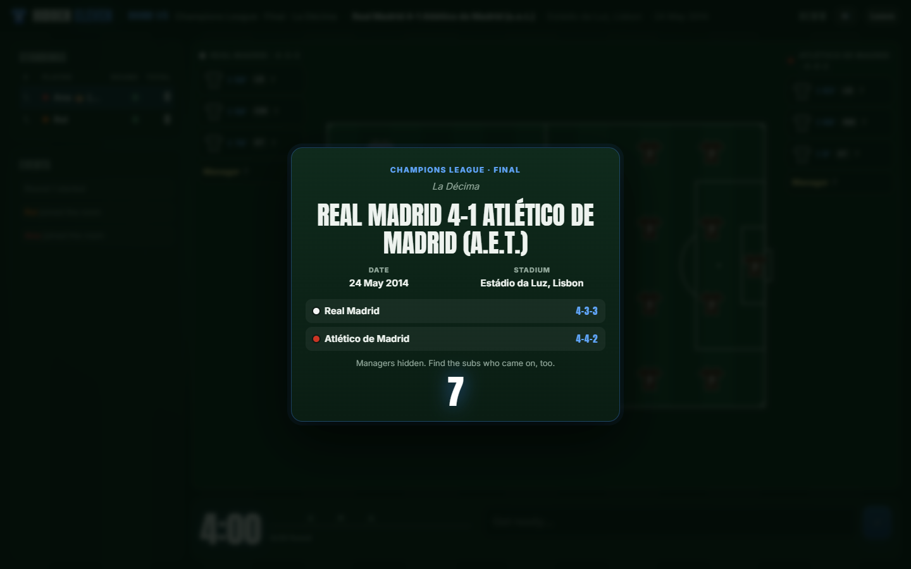

<div align="center">



**A real-time multiplayer football trivia game: uncover the hidden line-ups of legendary matches with your friends.**<br>
The starting elevens appear with the names hidden. Type a name first and the spot is yours. Free to host on Cloudflare.

<a href="https://hidden-eleven.bacoinz.workers.dev"></a>  <a href="LICENSE.md"></a>    <a href="https://ko-fi.com/bacoinz"></a>

[**▶ Play now**](https://hidden-eleven.bacoinz.workers.dev) · [How to play](#how-to-play) · [Run your own](#run-your-own) · [Report a bug](https://github.com/bacoinz/hidden-eleven/issues/new/choose) · [🇵🇹 Português](README.pt-PT.md)

</div>

> [!TIP]
> **Try it right now:** open **[hidden-eleven.bacoinz.workers.dev](https://hidden-eleven.bacoinz.workers.dev)**, create a room and share the link with your friends (Discord works great), or press **Play solo**. No account, no install.

## Why Hidden Eleven

You know the match: the 2016 Champions League final, Brazil 1–7 Germany, a Benfica–Porto derby from 2010. Do you know the *line-up*? Hidden Eleven shows you the pitch with every shirt hidden, and everybody types names at the same time. The first to type a name gets that spot, so it is as much about speed as about memory.

It is built for a group of friends on a call: a round takes a few minutes, the room saves itself, and there is nothing to set up.

## Features

**The game**

- **162 real matches** with the line-ups, formations, substitutes (with the minute they came on), managers and goals:
  - **Finals** (38): Champions League 2000–2026, World Cup 2002–2026 and Euros 2000–2024;
  - **Classics** (124): Portugal at every Euro and World Cup knockout since 2002, a Benfica–Porto, Benfica–Sporting and Porto–Sporting derby for every season since 2006/07, the European nights of the three big clubs, and other famous matches;
  - **Legendary Team:** pick a club or national team and play only its matches, with just that team on the pitch (Benfica, FC Porto, Sporting, Portugal, Real Madrid, Barcelona, the Manchester clubs, and more).
- **Type any name, anywhere.** Surnames, nicknames and small typos count ("drogab" finds Drogba), and nobody has to pick a position: the game finds it.
- **Hints:** as the clock runs down, the shirt numbers, flags and surname initials appear. The subs' positions are visible from the start, and the managers get the initial.
- **Points:** 5 for a starter with no hints, then 4, 3 and 2. Subs and managers are worth 3. Whoever fills the last spot gets +2. Every correct name adds 1 second, and a wrong one locks your box for 1 second.
- **Skip round:** nobody knows any more? Everyone confirms and the round ends, but each player keeps only half of their points from it. The cut shows up in the events as negative points.
- **Duel mode:** each player gets one of the two teams (they swap every round) and can only find their own. Whoever completes their eleven first wins the round and +10.
- **Solo or multiplayer:** 4:00 rounds with friends (up to 10 players) or 6:00 rounds on your own.

**Around the match**

- **Spectators:** anyone who joins mid-round watches it, and plays from the next one.
- **End of round:** per-player stats (correct names, wrong names, accuracy, time to the first one), the fastest and the most accurate, and a minute-by-minute scoresheet with the goals, penalties, own goals and substitutions.
- **Sounds and vibration** on phones, with an on/off button.
- **English and Portuguese,** switchable in the menu.
- **Works on phones:** the pitch turns vertical and the clock and the name box stay on top, so the keyboard doesn't hide them.

## Screenshots

<table>
  <tr>
    <td width="66%"></td>
    <td width="34%"></td>
  </tr>
  <tr>
    <td></td>
    <td></td>
  </tr>
</table>

## How to play

1. **Open the game** at [hidden-eleven.bacoinz.workers.dev](https://hidden-eleven.bacoinz.workers.dev), type a name and press **Create room** (or **Play solo**). Share the room link with your friends.
2. In the lobby, the host chooses the **content** (Finals, Classics, Legendary Team or Random), the number of **rounds** (3, 5 or 10) and the **mode** (Everyone or Duel), then presses **Start**.
3. A **match sheet** shows the match for 7 seconds, then the clock starts.
4. **Type names** and press <kbd>Enter</kbd>. If the name is in the starting eleven, a sub who came on or a manager, the spot is yours. You can start typing anywhere on the page.
5. **Watch the hints** appear at 80 %, 65 % and 50 % of the starting time.
6. The round ends when time runs out or everything is found. With the whole eleven found you can press **End round** (everybody confirms), and at any point you can press **Skip round**.
7. After the last round, the **final standings** show the winner.

The full rules are in the in-game **How to play** menu.

## Run your own

You need Node 22+ and, to put it online, a free Cloudflare account. It takes about 10 minutes, and there is nothing to configure: no database, no secrets.

```bash
git clone https://github.com/bacoinz/hidden-eleven && cd hidden-eleven
npm install
npm run dev
```

The game runs at `http://127.0.0.1:8787`. To try it with two players on one computer, open one tab on `http://localhost:8787` and another on `http://127.0.0.1:8787` (different origins count as different players).

**Putting it online:**

1. Log in to Cloudflare from the terminal: `npx wrangler login`.
2. Optional: change the Worker name in `wrangler.jsonc` (`"name"`), which becomes your address: `https://<name>.<your-subdomain>.workers.dev`.
3. Deploy: `npm run deploy`.

That's it: share the address with your friends. The first deploy creates the Durable Object that stores the rooms.

**Adding matches:** each match is a JSON file in `data/jogos/`, and there are importers that read Wikipedia and zerozero. See [docs/dados.md](docs/dados.md) (in Portuguese, so an AI assistant can walk you through it in your language).

## What it costs

Nothing, on Cloudflare's free plans. Each room is one Durable Object (SQLite storage), and the game sends small messages over a WebSocket that hibernates while nobody plays. Empty rooms delete themselves after 2 hours.

| Service | Free plan | What it means here |
|---|---|---|
| Workers | 100,000 requests/day | Pages, assets and actions for many games a day |
| Durable Objects (SQLite) | Free tier included | One per room |

## How it works

| Part | What it uses |
|---|---|
| Server | **Cloudflare Workers** + one **Durable Object** per room (WebSockets with hibernation, one alarm for the next deadline) |
| Game logic | Plain JavaScript, pure functions shared by the server and the tests |
| Interface | Plain HTML, CSS and JavaScript modules, no framework and no bundler |
| Match data | JSON files in `data/jogos/`, bundled into the Worker at build time |

- **The hidden names never reach your browser.** The server only sends a name once it has been found (or when the round ends), and the tests check that.
- **The server is authoritative:** the browser only sends the typed text, and the server decides.
- **Few dependencies:** only Wrangler and Vitest for development, plus the flag icons and the two fonts, which the app serves itself.
- **Translations:** the game is written in Portuguese and [`public/js/ingles.js`](public/js/ingles.js) holds the English for every text, including the server's messages.
- **Tests:** 103, with Vitest. They cover the name matcher, the scoring and hints, the room (duel, spectators, skipping, stats), the formations and the validation of every match file. `npm run e2e` plays a whole round with two real WebSocket clients.

```
src/        Worker and Durable Object (the room), game logic
public/     Interface (HTML, CSS, JS modules), flags, fonts, translations
data/       The matches (jogos/*.json) and the Legendary Team list
scripts/    Importers, validation, end-to-end test, screenshots
docs/       Data and import notes (Portuguese), screenshots
test/       Tests (Vitest)
```

Useful commands: `npm run dev`, `npm test`, `npm run validar`, `npm run e2e`, `npm run deploy`.

## Found a bug?

This is version **1.0**, and there will be bugs. If you find one, please **[open an issue](https://github.com/bacoinz/hidden-eleven/issues/new/choose)** saying what you did, what happened and, if you can, a screenshot. A wrong shirt number, a misspelt name or a wrong position in a match are bugs too, and very welcome. You can write in English or Portuguese.

## Support

Hidden Eleven is free and has no ads. If you enjoyed it, you can buy me a coffee:

<a href="https://ko-fi.com/bacoinz"></a>

## Credits

- Line-ups, substitutions and goals come from [Wikipedia](https://www.wikipedia.org) (CC BY-SA) and [zerozero.pt](https://www.zerozero.pt), and the positions of recent matches from [FotMob](https://www.fotmob.com). Everything was reviewed by hand, but mistakes are possible: please report them.
- Flags: [flag-icons](https://github.com/lipis/flag-icons) (MIT). Fonts: Anton and Inter (OFL).
- Hidden Eleven is a fan-made game, not affiliated with any club, federation or competition.

## License

[PolyForm Noncommercial 1.0.0](LICENSE.md). Free of charge, you can use it, change it and host it for yourself and your friends, a school or a non-profit. Selling it, or selling access to it as a service, is not allowed. For anything commercial, ask the author.
