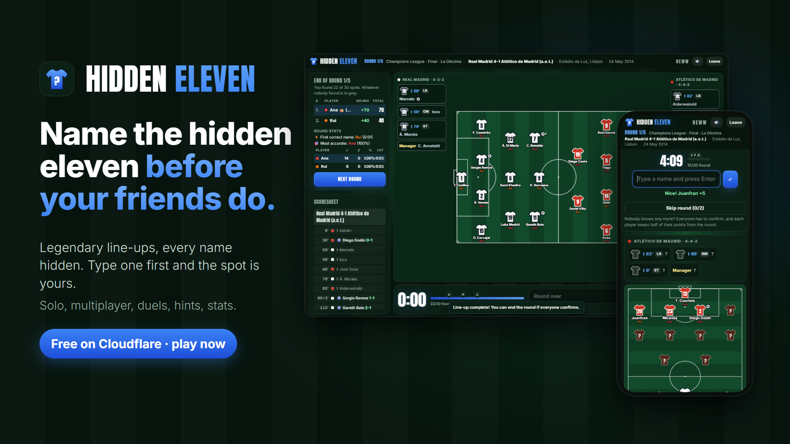
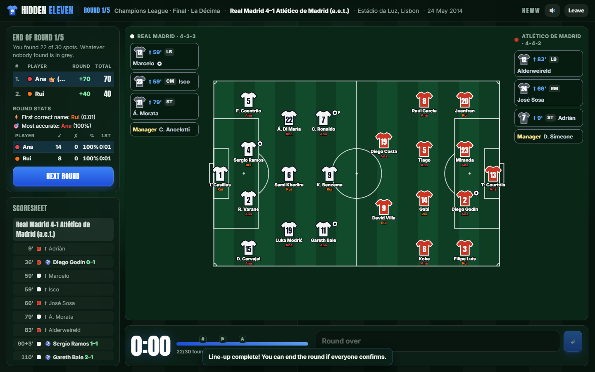
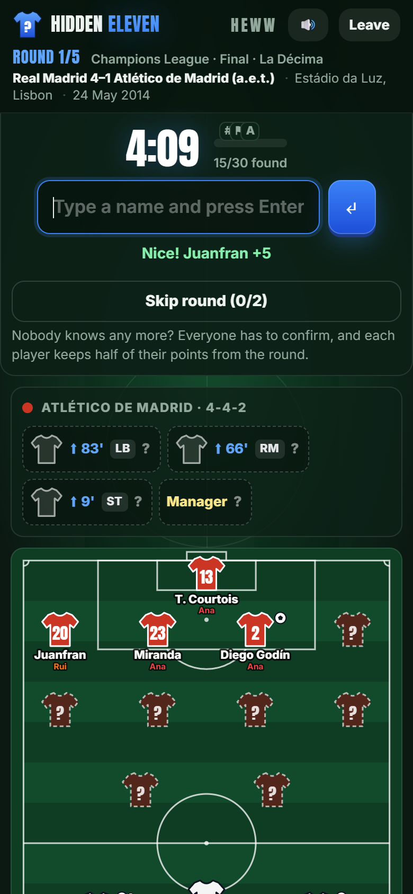
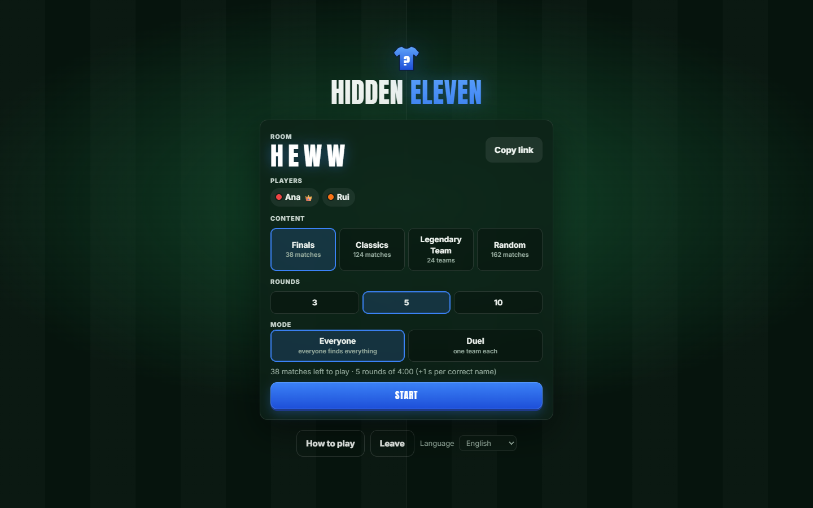
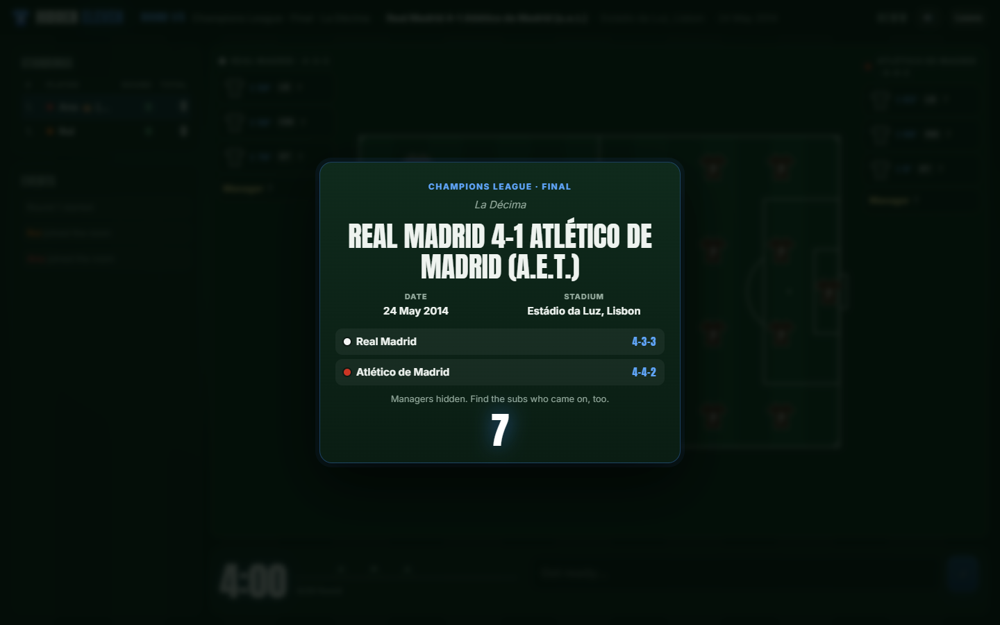

<div align="center">



**Um jogo de futebol multijogador em tempo real: descobre os onzes escondidos de jogos míticos com os teus amigos.**<br>
Aparecem os onzes com os nomes escondidos. Quem escrever primeiro um nome fica com a posição. Aloja-se de graça na Cloudflare.

<a href="https://hidden-eleven.bacoinz.workers.dev"></a>  <a href="LICENSE.md"></a>    <a href="https://ko-fi.com/bacoinz"></a>

[**▶ Jogar agora**](https://hidden-eleven.bacoinz.workers.dev) · [Como jogar](#como-jogar) · [Alojar o teu](#alojar-o-teu) · [Reportar um bug](https://github.com/bacoinz/hidden-eleven/issues/new/choose) · [🇬🇧 English](README.md)

</div>

> [!TIP]
> **Experimenta já:** abre **[hidden-eleven.bacoinz.workers.dev](https://hidden-eleven.bacoinz.workers.dev)**, cria uma sala e partilha o link com os teus amigos (no Discord funciona muito bem), ou carrega em **Jogar sozinho**. Sem conta e sem instalar nada.

## Porquê o Hidden Eleven

Conheces o jogo: a final da Liga dos Campeões de 2016, o Brasil 1–7 Alemanha, um Benfica–Porto de 2010. Mas sabes o *onze*? O Hidden Eleven mostra o relvado com todas as camisolas escondidas e toda a gente escreve nomes ao mesmo tempo. Quem escrever primeiro fica com a posição, por isso conta tanto a velocidade como a memória.

Foi feito para um grupo de amigos numa chamada: uma ronda dura uns minutos, a sala guarda-se sozinha e não há nada para configurar.

## Funcionalidades

**O jogo**

- **162 jogos reais** com onzes, formações, suplentes (com o minuto em que entraram), treinadores e golos:
  - **Finais** (38): Liga dos Campeões 2000–2026, Mundiais 2002–2026 e Europeus 2000–2024;
  - **Clássicos** (124): Portugal em todas as eliminatórias de Europeus e Mundiais desde 2002, um Benfica–Porto, Benfica–Sporting e Porto–Sporting por época desde 2006/07, as noites europeias dos três grandes e outros jogos famosos;
  - **Equipa Mítica:** escolhes um clube ou seleção e jogas só os jogos dessa equipa, com ela sozinha no relvado (Benfica, FC Porto, Sporting, Portugal, Real Madrid, Barcelona, os clubes de Manchester e mais).
- **Escreve qualquer nome, em qualquer lado.** Apelidos, alcunhas e pequenas gralhas contam ("drogab" encontra o Drogba), e ninguém escolhe a posição: o jogo trata disso.
- **Pistas:** à medida que o relógio desce, aparecem os números das camisolas, as bandeiras e as iniciais dos apelidos. A posição dos suplentes vê-se desde o início e os treinadores recebem a inicial.
- **Pontos:** 5 por um titular sem pistas, depois 4, 3 e 2. Suplentes e treinadores valem 3. Quem fecha a última posição ganha +2. Cada acerto dá +1 segundo e um nome errado bloqueia a tua caixa durante 1 segundo.
- **Passar ronda:** ninguém sabe mais? Todos confirmam e a ronda acaba, mas cada um fica só com metade dos pontos que fez nela. O corte aparece nos acontecimentos, com pontos negativos.
- **Modo duelo:** cada jogador fica com uma das duas equipas (trocam em cada ronda) e só descobre a sua. Quem fechar primeiro o seu onze ganha a ronda e +10.
- **Solo ou multijogador:** rondas de 4:00 com amigos (até 10 jogadores) ou de 6:00 sozinho.

**À volta do jogo**

- **Espectadores:** quem entra a meio de uma ronda fica a vê-la e joga a partir da seguinte.
- **Fim da ronda:** estatísticas por jogador (acertos, erros, precisão, tempo até ao primeiro acerto), o mais rápido e o mais certeiro, e um marcador minuto a minuto com golos, penáltis, autogolos e substituições.
- **Sons e vibração** no telemóvel, com um botão para ligar e desligar.
- **Português e inglês,** à escolha no menu.
- **Funciona no telemóvel:** o relvado fica na vertical e o relógio e a caixa de nomes ficam no topo, para o teclado não os tapar.

## Imagens

<table>
  <tr>
    <td width="66%"></td>
    <td width="34%"></td>
  </tr>
  <tr>
    <td></td>
    <td></td>
  </tr>
</table>

<sub>As imagens estão em inglês; o jogo muda de língua no menu.</sub>

## Como jogar

1. **Abre o jogo** em [hidden-eleven.bacoinz.workers.dev](https://hidden-eleven.bacoinz.workers.dev), escreve um nome e carrega em **Criar sala** (ou **Jogar sozinho**). Partilha o link da sala com os teus amigos.
2. No lobby, o anfitrião escolhe o **conteúdo** (Finais, Clássicos, Equipa Mítica ou Aleatório), o número de **rondas** (3, 5 ou 10) e o **modo** (Todos ou Duelo) e carrega em **Começar**.
3. Uma **ficha do jogo** aparece durante 7 segundos e depois o relógio arranca.
4. **Escreve nomes** e carrega em <kbd>Enter</kbd>. Se o nome for do onze, de um suplente que entrou ou de um treinador, a posição é tua. Podes começar a escrever em qualquer parte da página.
5. **Repara nas pistas** que aparecem quando o relógio desce a 80 %, 65 % e 50 % do tempo inicial.
6. A ronda acaba quando o tempo acaba ou está tudo descoberto. Com o onze todo descoberto podes carregar em **Terminar ronda** (todos confirmam), e a qualquer altura em **Passar ronda**.
7. Depois da última ronda, a **classificação final** mostra o vencedor.

As regras completas estão no menu **Como jogar**, dentro do jogo.

## Alojar o teu

Precisas do Node 22+ e, para o pôr online, de uma conta Cloudflare gratuita. Demora uns 10 minutos e não há nada para configurar: sem base de dados e sem segredos.

```bash
git clone https://github.com/bacoinz/hidden-eleven && cd hidden-eleven
npm install
npm run dev
```

O jogo corre em `http://127.0.0.1:8787`. Para experimentar com dois jogadores no mesmo computador, abre um separador em `http://localhost:8787` e outro em `http://127.0.0.1:8787` (origens diferentes contam como jogadores diferentes).

**Pôr online:**

1. Entra na Cloudflare pelo terminal: `npx wrangler login`.
2. Opcional: muda o nome do Worker em `wrangler.jsonc` (`"name"`), que passa a ser o teu endereço: `https://<nome>.<o-teu-subdominio>.workers.dev`.
3. Publica: `npm run deploy`.

E pronto: partilha o endereço com os teus amigos. A primeira publicação cria o Durable Object que guarda as salas.

**Acrescentar jogos:** cada jogo é um ficheiro JSON em `data/jogos/`, e há importadores que leem a Wikipédia e o zerozero. Vê [docs/dados.md](docs/dados.md).

## Quanto custa

Nada, nos planos gratuitos da Cloudflare. Cada sala é um Durable Object (armazenamento SQLite) e o jogo troca mensagens pequenas por um WebSocket que hiberna enquanto ninguém joga. As salas vazias apagam-se sozinhas ao fim de 2 horas.

| Serviço | Plano gratuito | O que significa aqui |
|---|---|---|
| Workers | 100 000 pedidos/dia | Páginas, ficheiros e ações de muitos jogos por dia |
| Durable Objects (SQLite) | Escalão gratuito incluído | Um por sala |

## Como funciona

| Parte | O que usa |
|---|---|
| Servidor | **Cloudflare Workers** + um **Durable Object** por sala (WebSockets com hibernação e um alarme para o próximo prazo) |
| Lógica do jogo | JavaScript simples, funções puras partilhadas pelo servidor e pelos testes |
| Interface | HTML, CSS e módulos JavaScript simples, sem framework nem bundler |
| Dados dos jogos | Ficheiros JSON em `data/jogos/`, juntos ao Worker ao compilar |

- **Os nomes escondidos nunca chegam ao teu browser.** O servidor só envia um nome depois de descoberto (ou quando a ronda acaba), e os testes verificam isso.
- **O servidor é que manda:** o browser só envia o texto escrito e o servidor decide.
- **Poucas dependências:** só o Wrangler e o Vitest para desenvolver, mais os ícones das bandeiras e as duas fontes, que a própria app serve.
- **Traduções:** o jogo está escrito em português e [`public/js/ingles.js`](public/js/ingles.js) tem o inglês de cada texto, incluindo as mensagens do servidor.
- **Testes:** 103, com Vitest. Cobrem a procura de nomes, os pontos e as pistas, a sala (duelo, espectadores, passar ronda, estatísticas), as formações e a validação de todos os ficheiros de jogos. O `npm run e2e` joga uma ronda inteira com dois clientes WebSocket a sério.

```
src/        Worker e Durable Object (a sala), lógica do jogo
public/     Interface (HTML, CSS, módulos JS), bandeiras, fontes, traduções
data/       Os jogos (jogos/*.json) e a lista da Equipa Mítica
scripts/    Importadores, validação, teste de ponta a ponta, imagens
docs/       Notas dos dados e da importação, imagens
test/       Testes (Vitest)
```

Comandos úteis: `npm run dev`, `npm test`, `npm run validar`, `npm run e2e`, `npm run deploy`.

## Encontraste um bug?

Esta é a versão **1.0** e vai haver bugs. Se encontrares um, **[abre uma issue](https://github.com/bacoinz/hidden-eleven/issues/new/choose)** a dizer o que fizeste, o que aconteceu e, se puderes, com uma imagem. Um número de camisola errado, um nome mal escrito ou uma posição errada num jogo também são bugs, e são muito bem-vindos. Podes escrever em português ou em inglês.

## Apoiar

O Hidden Eleven é grátis e não tem anúncios. Se gostaste, podes pagar-me um café:

<a href="https://ko-fi.com/bacoinz"></a>

## Créditos

- Os onzes, as substituições e os golos vêm da [Wikipédia](https://www.wikipedia.org) (CC BY-SA) e do [zerozero.pt](https://www.zerozero.pt), e as posições dos jogos recentes do [FotMob](https://www.fotmob.com). Tudo foi revisto à mão, mas pode haver erros: diz-me quais.
- Bandeiras: [flag-icons](https://github.com/lipis/flag-icons) (MIT). Fontes: Anton e Inter (OFL).
- O Hidden Eleven é um jogo feito por um fã, sem ligação a nenhum clube, federação ou competição.

## Licença

[PolyForm Noncommercial 1.0.0](LICENSE.md). Sem custos, podes usá-lo, alterá-lo e alojá-lo para ti e para os teus amigos, uma escola ou uma organização sem fins lucrativos. Vendê-lo, ou vender o acesso a ele como serviço, não é permitido. Para qualquer uso comercial, fala com o autor.
